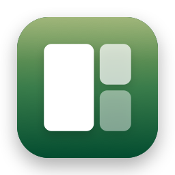

# Snapdeck

A small, native window manager for macOS that works like window management on Windows:
snap windows with the keyboard or by dragging them to a screen edge, define your own
layouts, and save and restore whole window setups.

Written in Swift using only Apple system frameworks. No third-party dependencies.

## Features

- **Keyboard snapping** with Windows-style behaviour: halves, quarters, maximise, restore.
  Pressing left or right again moves the window to the next display.
- **Drag to edge**: drag a window to the left, right or top edge (or a top/side corner)
  and drop it on the preview.
- **Drop into a layout zone**: hold Shift while dragging a window to see the active
  layout's zones, and drop the window into one.
- **Snap groups**: windows that Snapdeck arranged on a screen come forward together
  when you switch to one of them, so the arrangement is not left half covered.
- **Layouts**: named combinations of zones, such as "Main + Stack". Send the focused
  window to a zone, or arrange the front-most windows into the layout in one step.
- **Setups**: save where all your windows are and restore that arrangement later.
  Apps that are not running are launched first.
- **Per-display arrangements** (optional, off by default): Snapdeck remembers where
  windows were for each combination of displays and puts them back when you connect
  or disconnect a monitor.
- **Ignore list**: apps whose windows Snapdeck should never move (Settings → General).
- **Hover previews**: hovering over an item in the menu bar menu shows on screen
  where the window (or windows) would go.
- **Settings** (`⌘,` while the menu is open): launch at login, gap between windows,
  modifier keys for the shortcuts, active layout, saved setups.

## Shortcuts

These are the defaults. In Settings → Shortcuts you can change the modifier keys for
all of them, or click a shortcut and press new keys to change just that one.

| Shortcut | Action |
| --- | --- |
| `⌃⌥←` / `⌃⌥→` | Left / right half; from a quarter, move sideways; again, next display |
| `⌃⌥↑` | Half → top quarter, otherwise maximise |
| `⌃⌥↓` | Top quarter → half → bottom quarter, otherwise restore the original size |
| `⌃⌥↩` | Maximise |
| `⌃⌥C` | Centre |
| `⌃⌥⌘` + arrow | Move the window to the display in that direction, keeping its place |
| `⌃⌥1` … `⌃⌥9` | Move the window to that zone of the active layout |
| `⌃⌥A` | Arrange the front-most windows into the active layout |

## Install

Releases are published on GitHub and can be installed with Homebrew:

```bash
brew tap DeBlo12/snapdeck https://github.com/DeBlo12/Snapdeck
```

```bash
brew install --cask snapdeck
```

Release builds are ad-hoc signed and not notarised by Apple, so macOS blocks them
on first launch. Allow the app under System Settings → Privacy & Security → "Open
Anyway", or build from source as described below. Because of the ad-hoc signature,
Accessibility access has to be granted again after each update.

Maintainers publish a release by pushing a tag such as `v0.2.0`.

## Build and run

Requires macOS 13 or later and the Swift toolchain (Xcode or the Command Line Tools).

```bash
./scripts/bundle.sh
```

```bash
open build/Snapdeck.app
```

On first launch macOS asks for **Accessibility** access (System Settings → Privacy &
Security → Accessibility). This is the only supported way for an app to move other
apps' windows. Snapdeck appears in the menu bar and has no Dock icon.

Run the unit tests with:

```bash
swift test
```

## Configuration

Config lives in `~/Library/Application Support/Snapdeck` (Settings → Layouts → *Edit layouts.json*).

Layouts are created and changed in Settings → Layouts: select a zone, split it side
by side or stacked, and drag its handles. Neighbouring zones follow a shared divider.

`layouts.json` holds the layouts and can also be edited by hand. Each zone is a
fraction of the usable screen area, measured from the top-left corner:

```json
[
  {
    "name": "Main + Stack",
    "zones": [
      { "x": 0,   "y": 0,   "width": 0.6, "height": 1 },
      { "x": 0.6, "y": 0,   "width": 0.4, "height": 0.5 },
      { "x": 0.6, "y": 0.5, "width": 0.4, "height": 0.5 }
    ]
  }
]
```

Press *Reload* in the settings after editing. `setups.json` is written by
*Save Current Setup…*.

## Known limitations

- macOS has its own edge tiling (System Settings → Desktop & Dock → "Drag windows to
  screen edges to tile"). Turn it off if both previews appear.
- Setups match windows by app and window title, then by order. Apps with many
  similar windows may be restored in a different order.
- There is no public API for moving windows between Spaces, so setups apply to the
  current Space.
- The app is ad-hoc signed by default. After rebuilding, macOS may ask you to grant
  Accessibility access again. To avoid that, sign with a certificate of your own:
  `CODESIGN_IDENTITY="<name or hash>" ./scripts/bundle.sh`.
- If Snapdeck is switched on in the Accessibility list but still reports that access
  is missing, the entry belongs to an older build. Quit Snapdeck, run
  `tccutil reset Accessibility dev.snapdeck.Snapdeck`, start it again and grant access.
- The zone shortcuts (1–9) always use the default modifier keys and digits.

## Security

Snapdeck needs the Accessibility permission, so it is built to give other software
as little to hold on to as possible:

- No network access, no update mechanism, no telemetry, no third-party code.
- No URL scheme, scripting interface or other way for other programs to send it commands.
- It registers its own shortcuts and watches mouse button and drag events only.
  It never reads keystrokes or the contents of windows.
- The app is signed with the hardened runtime, which stops other programs from
  injecting code into it to borrow its Accessibility permission.
- Saved setups store a SHA-256 hash of each window title, not the title, and the
  config files are readable by your user only.
- Restoring a setup asks before it opens apps that are not running.

Prebuilt binaries are not notarised by Apple. Build from source if you want to be
sure what you are granting Accessibility access to.

## Project structure

- `Sources/SnapdeckCore`: pure geometry and models, covered by unit tests.
- `Sources/Snapdeck`: the menu bar app (Accessibility, hotkeys, drag snapping, menu).
- `scripts/bundle.sh`: builds `build/Snapdeck.app`.
- `scripts/make-icon.sh`: redraws the app icon (`Support/AppIcon.icns`) from code.

## Licence

MIT. See [LICENSE](LICENSE).
